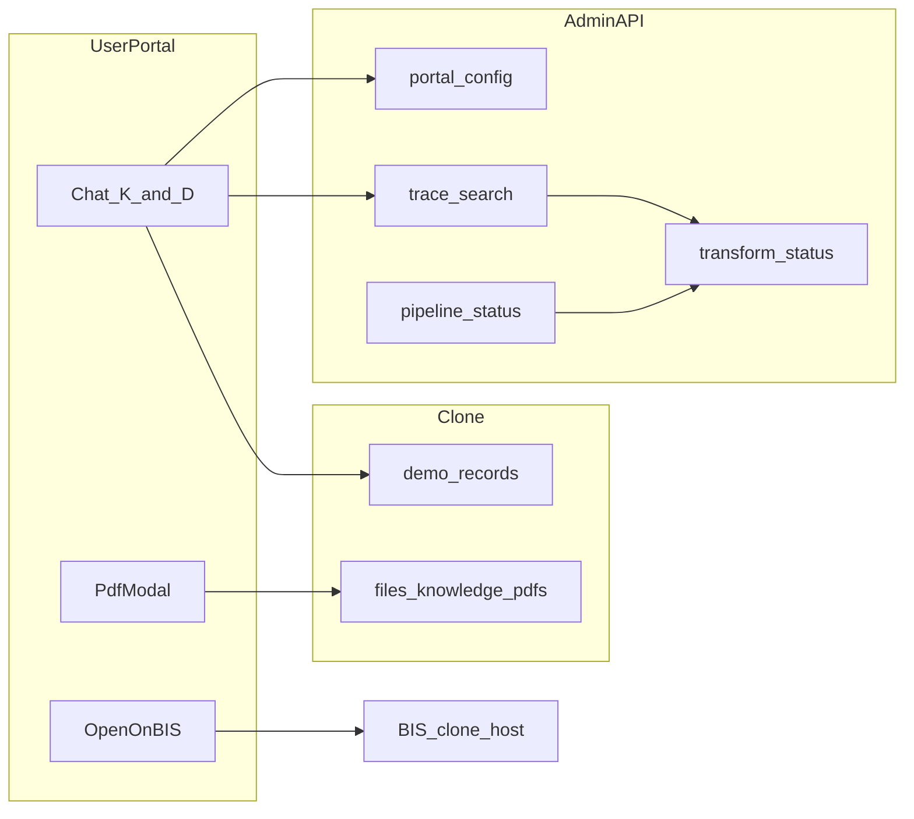

# BIS MITRA — User & Admin Virtual Evaluation Plan

**Version:** 1.0  
**Primary surfaces:** [bis-mitra-user](../bis-mitra-user) (Vercel), [bis-mitra-admin](../bis-mitra-admin) (Railway)  
**Related:** [TEST_MATRIX.md](TEST_MATRIX.md), [PROOF_ACTIONS_RUNBOOK.md](PROOF_ACTIONS_RUNBOOK.md), [PROD_TEST_REPORT.md](PROD_TEST_REPORT.md)

---

## 1. Goals

1. Prove features work end-to-end with **explicit expected outcomes** (not “page loads”).
2. **Simulate a real user** across personas, Knowledge / BIS data modes, chat, response cards, PDF, Open on BIS, applications, alerts, saved items.
3. **Evaluate agent answers** against indexed sources and clone demo records.
4. Maintain loop: **test → bug → RCA → fix → retest → update this doc + automation**.

---

## 2. Scope

| In scope | Out of scope |
|----------|----------------|
| Admin API/UI + user portal | Full crawl of live bis.gov.in |
| Cited Open on BIS URLs only | Chit-chat as knowledge success (`hi` / `hello` — see N-* suite) |
| Clone API where portal depends on it | |

**Production cluster:** `mitra-knowledge` (render-seed ~68 warehouse items; volume may differ after fetch/transform).

---

## 3. Phase 0 — Preflight

Run before every virtual-user session or prod deploy sign-off.

| Check | How | Pass |
|-------|-----|------|
| Admin health | `GET {ADMIN_API}/api/health` | 200 |
| Portal config | `GET {ADMIN_API}/api/portal/config` | `publishedClusterId` set; `cloneApi` set; `cloneFilesBase` ends with **`/files`** (not `/files/pdfs`) |
| Transform status | `GET {ADMIN_API}/api/transform/mitra-knowledge/status` | `ready` + live/draft manifests |
| Index / hosted RAG | `GET {ADMIN_API}/api/retrieval/index-status?clusterId=mitra-knowledge` or chat trace | Note if `hostedIndexSkipped` (Railway + index >32MB) |
| Clone health | `GET {CLONE_API}/api/health` | 200; demo records if running proof suite |
| User portal | Load `bis-mitra-user` prod URL | Config bootstrap, no unpublished banner (when cluster published) |

**Env (prod example):**

```powershell
$env:ADMIN_API="https://bismitra-production.up.railway.app"
$env:CLONE_API="https://bis-clone-production.up.railway.app"
cd bis-mitra-admin
npm run test:preflight
npm run test:prod:gate
```

Record results in [PROD_TEST_REPORT.md](PROD_TEST_REPORT.md).

---

## 4. Virtual user simulation (manual script)

**Duration:** ~45–90 minutes per full run.

1. Open user portal → confirm published cluster label.
2. **Persona loop** (minimum: Industry, Foreign exporter, Citizen):
   - Knowledge mode → run **K-*** prompts (§5).
   - BIS data mode → run **D-*** prompts where applicable (§6).
3. For each answer with sources:
   - **View document** (PDF modal) — must render, not `Cannot GET /files/...`.
   - **Open on BIS** — page loads with document or section (log failures in link registry).
   - **Open in new tab** — same URL sanity.
4. Sidebar: Home, My Applications, My Alerts, Documents, BIS Services, Saved (smoke navigation).
5. Optional: voice mic, file attach, save snippet (manual).
6. **Admin parallel:** §7 checklist on Railway admin UI + API.

---

## 5. Pass / fail rubric

| Dimension | Pass | Fail |
|-----------|------|------|
| UI | Expected `data-testid` or section visible | Error, blank card, timeout |
| PDF | HTTP 200, `application/pdf` | 404 / wrong path |
| BIS link | Target loads; PDF or content present **or** documented known demo gap | Dead page with no user message |
| Answer | `mustContain` from golden Q&A ([eval/mitra-knowledge-golden-qa.json](eval/mitra-knowledge-golden-qa.json)) | Wrong IS/QCO or “insufficient evidence” when anchor indexed **and** search not skipped |
| Safety | Refusal when no evidence | Hallucinated standard numbers |

Log: prompt, persona, mode, expected, actual, screenshot, ticket/RCA.

---

## 6. Knowledge prompt suite (`mitra-knowledge`)

Natural language prompts grounded in render-seed corpus. Automated via `npm run test:eval:knowledge` (admin API).

### 6.1 Process & licensing

| ID | User prompt | Minimum expected | Source anchor |
|----|-------------|------------------|---------------|
| K-01 | What is the procedure for **change in scope of licence (CSoL)** under Scheme I? | CSoL / scope change steps or Regulation 9 | `process-change-in-scope-of-licence.pdf` |
| K-02 | Explain **general principles for grant of licence (GoL)** for BIS certification. | GoL principles | `process-grant-of-licence-guidelines-2026.pdf` |
| K-03 | What happens during **factory surveillance** under BIS? | Surveillance process | `process-factory-surveillance-2026.pdf` |
| K-04 | How do I **renew my certificate of conformity (CoC)**? | Renewal procedure | `process-renewal-of-coc-guidelines.pdf` |
| K-05 | What is **market surveillance** and when does BIS use it? | Market surveillance | `process-market-surveillance-2026.pdf` |

### 6.2 Schemes, QCO, fees

| ID | User prompt | Minimum expected | Source anchor |
|----|-------------|------------------|---------------|
| K-06 | Is my product on the **compulsory certification list**? How do I check? | Compulsory list / scheme | `schemes-compulsory-products-list.pdf` |
| K-07 | What is a **QCO** and how does it relate to Indian Standards? | QCO explanation | `schemes-guidance-document-on-qcos.pdf` |
| K-08 | What are **marking fees** for BIS certification in 2026? | Fee content | `schemes-marking-fee-all-products-2026.pdf` |
| K-09 | Can I use **simplified procedure (Option 2)** for product certification? | Option 2 / simplified procedure | `schemes-simplified-procedure-products.pdf` |

### 6.3 Hallmarking

| ID | User prompt | Minimum expected | Source anchor |
|----|-------------|------------------|---------------|
| K-10 | Is **gold hallmarking** mandatory in my district? | Mandatory / phase / districts | `hallmarking-phase-wise-mandatory-districts.pdf` or mandatory order |
| K-11 | How does a **jeweller register** for BIS hallmarking? | Registration steps | `hallmarking-guide-jeweller-registration.pdf` |

### 6.4 Labs

| ID | User prompt | Minimum expected | Source anchor |
|----|-------------|------------------|---------------|
| K-12 | What is the **BIS laboratory recognition scheme (LRS)**? | LRS overview | `labs-lab-recognition-scheme-2020.pdf` |
| K-13 | Where can I find **BIS recognised labs (Group 1)**? | Lab list theme | `labs-group-1-recognised-labs-2026.pdf` |

### 6.5 Manuals & standards (in corpus)

| ID | User prompt | Minimum expected | Source anchor |
|----|-------------|------------------|---------------|
| K-14 | What tests are required for **IS 4151 industrial safety helmets**? | Test requirements | `manuals-PM-IS-4151-helmet-2024.pdf` |
| K-15 | What is BIS **training strategy** for standards education? | Training strategy | `standards-training-strategy-2023.pdf` |

### 6.6 Consumer

| ID | User prompt | Minimum expected | Source anchor |
|----|-------------|------------------|---------------|
| K-16 | How do I **complain about a BIS-certified product**? | Complaint procedure | `consumer-complaint-guidelines-certified-products-2023.pdf` |

**Note:** On Railway, if hosted index skip is active, K-* may fail until retrieval fix or local full index — document in PROD_TEST_REPORT.

---

## 7. Negative & guardrail prompts

| ID | Prompt | Expected behavior |
|----|--------|-------------------|
| N-01 | `Hi` / `Hello` | Brief greeting; steer to BIS/certification question |
| N-02 | What is the weather in Delhi? | Polite out-of-scope refusal |
| N-03 | Explain General Principles for CSoL | CSoL doc or clarify CSoL vs GoL |
| N-04 | Explain IS 99999:2099 certification | Insufficient evidence; no fabricated IS |
| N-05 | (HI) बीआईएस लाइसेंस के लिए आवेदन कैसे करें? | Answer or supported i18n per product spec |

---

## 8. Demo workflow prompts (BIS data / clone)

Align with [PROOF_ACTIONS_RUNBOOK.md](PROOF_ACTIONS_RUNBOOK.md).

| ID | Persona | Prompt (summary) | Expected UI | API |
|----|---------|------------------|-------------|-----|
| D-01 | Industry | Industrial safety helmets — standard, mandatory?, tests, docs | `portal-compliance-card` | `test:proof:01` |
| D-02 | Industry | Apply for certification IS DEMO 1001… | Confirm → application ID | `test:proof:02` |
| D-03 | Industry | Status of application {id} | Status + alerts | `test:proof:03` |
| D-04 | Foreign exporter | FMCS induction cooker India | `portal-checklist-card` | `test:proof:04` |
| D-05 | Industry | Lab for IS DEMO 1003 | `portal-matching-card` | `test:proof:05` |
| D-06 | Citizen | Verify CML-DEMO-61003 | `portal-verify-card` | `test:proof:06` |

Playwright: [proof-actions-quick.spec.js](../bis-mitra-user/e2e/proof-actions-quick.spec.js), [knowledge-smoke.spec.js](../bis-mitra-user/e2e/knowledge-smoke.spec.js).

---

## 9. Admin evaluation

| ID | Area | Action | Expected |
|----|------|--------|----------|
| A-01 | Clusters | Open `mitra-knowledge` | File count, published flag |
| A-02 | Transform | Status / incremental run (maintainer) | Golden/chunk/index update; promote → live |
| A-03 | Automation | `GET /api/automation/status` | Railway: scheduler off; events after manual transform |
| A-04 | Agent | Same prompt as K-01 | Trace shows retrieval; flag `hostedIndexSkipped` |
| A-05 | Publish | Publish/unpublish | User `portal/config` updates |
| A-06 | Ingest | Upload test PDF | Warehouse + transform event |
| A-07 | Stale index | After add without transform | Banner “index building” / pipeline status (**required after P5**) |

Pipeline status: `GET /api/pipeline/status` (cluster job + stale flag).

---

## 10. Link verification protocol

For each citation in a passing chat:

1. **Clone PDF:** `GET {cloneFilesBase}/knowledge/pdfs/...` → 200 PDF.
2. **In-app URL:** Built by [sourceToPdfUrl](../bis-mitra-user/src/portal/api.js) — must match clone mount (`/files/knowledge/pdfs/...`).
3. **Admin proxy (fallback):** `{ADMIN_API}/api/clone-files/knowledge/pdfs/...`.
4. **Open on BIS:** [openOnBisUrl](../bis-mitra-user/src/portal/portalProvenance.js) — manual or Playwright subset; record 404s.

---

## 11. Answer correctness layers

| Layer | Mechanism |
|-------|-----------|
| 1 — CI | [mitra-knowledge-golden-qa.json](eval/mitra-knowledge-golden-qa.json) `mustContain` / `mustNotContain` |
| 2 — Retrieval | Admin trace: top hit includes expected `sourceFiles[]` |
| 3 — Optional | Offline LLM judge on saved traces |

Product copy should distinguish: not in corpus · index stale/building · hosted search limited.

---

## 12. Implementation phases (P0–P6)

| Phase | Work | Deliverable |
|-------|------|-------------|
| **P0** | Preflight prod/local | PROD_TEST_REPORT table |
| **P1** | Manual virtual user + link log | Filled rubric in PROD_TEST_REPORT |
| **P2** | PDF URLs, cloneFilesBase, hosted RAG | Code + redeploy |
| **P3** | Golden Q&A + `test:eval:knowledge` | JSON + script |
| **P4** | Playwright PDF/BIS/knowledge smoke | e2e specs |
| **P5** | Admin pipeline UX + hosted transform hook | API + UI banner |
| **P6** | Full corpus (~240 files) | Re-run K-suite after transform/promote |

---

## 13. Known RCA backlog

| Issue | Symptom | Fix direction |
|-------|---------|---------------|
| PDF path | `Cannot GET /files/pdfs/knowledge/pdfs/...` | Normalize `sourceToPdfUrl`; fix `cloneFilesBase`; admin proxy fallback |
| Hosted RAG skip | Knowledge chat “insufficient evidence” for in-corpus topics | Disk-backed lexical search or raise RAM / shard index |
| Background jobs off | No auto poll on Railway | Upload/fetch → `runPostIngestTransform`; optional `ENABLE_HOSTED_PIPELINE=1` |
| Warehouse vs index | 240 files fetched, agent unchanged | Transform + promote; stale banner (A-07) |
| Open on BIS | Demo BIS page missing file | Map provenance to clone library paths |

---

## 14. Maintenance

- Re-run **§3 Phase 0 + §4 virtual user** after every Railway/Vercel prod deploy.
- Re-run `npm run test:eval:knowledge` on retrieval/agent changes.
- Update §6 anchors when warehouse corpus changes.
- Keep [TEST_MATRIX.md](TEST_MATRIX.md) command list in sync.

---

## 15. Architecture (evaluation flow)


